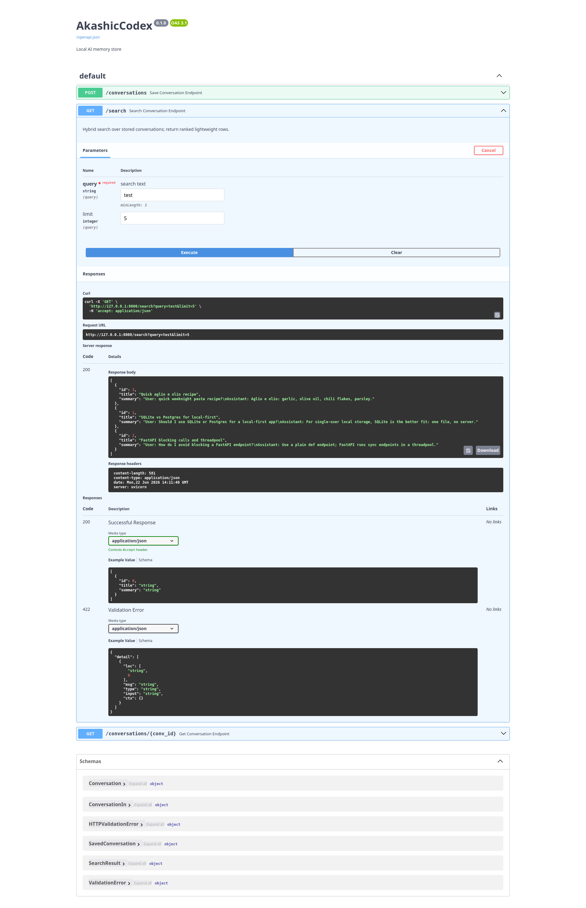

# AkashicCodex

[](https://github.com/Gardner-Programs/akashic-codex/actions/workflows/ci.yml)

A local, model-agnostic memory store for AI conversations.

The idea: your conversation history shouldn't live inside any one AI. AkashicCodex keeps it in a database you own, on your own machine, so you can switch freely between Claude, Gemini, a local Ollama model, or whatever comes next, and your context follows you. When one model runs out of usage, you switch to another and the memory is still there, because the memory *is* the database, not the model.

## Demo


Save conversations from different models, then find one with a query worded nothing like the original. Keyword and semantic search are fused, so the right conversation surfaces even with no shared words.

## How it works

Conversations are stored with a title and a short summary alongside the full transcript. Search happens in two tiers: first it ranks the lightweight summaries (fast and cheap), then it loads the full transcript only for a match (expensive, done rarely). Search is hybrid: keyword search via SQLite FTS5 for precision, plus semantic vector search via `sqlite-vec` so it finds the right conversation even when you phrase things differently than you did before.

At ingest, role-prefixed transcript lines are also parsed into a `messages` table
with ordered turns, role, content, and an optional model label (`Assistant
[model=name]: ...`). This structure is derived data: `conversations.full_log`
remains the source of truth, and transcripts without explicit model labels leave
the per-turn model empty.

Tags are generated at save time from the most frequent transcript keywords. Common English stopwords are filtered, words are normalized to lowercase, and punctuation is ignored; tag generation is deterministic and works offline.

Any model talks to the same simple core (save, search, get) through whichever interface fits: a CLI, a REST API, and an MCP server. No model-specific logic lives in the store, which is what makes models swappable.

## Stack

SQLite (single local file you own) + `sqlite-vec` for semantic search + a fixed local embedding model so vectors stay comparable and vendor-independent. FastAPI for the REST layer. Python throughout. The database layer is isolated in one module so migrating to Postgres + pgvector later, if ever needed, is a contained change.

## Quick start

```bash
python -m venv .venv && source .venv/bin/activate
pip install -r requirements.txt
cp .env.example .env
```

`requirements.txt` keeps direct dependencies within supported major-version
ranges. CI runs weekly against the newest releases in those ranges so upstream
changes are exercised before they can break a fresh install.

### CLI

```bash
python -m akashic_codex.cli init
python -m akashic_codex.cli save examples/sqlite_decision.txt --title "Why we chose SQLite" --source claude
python -m akashic_codex.cli search "what database did we pick for local storage"
python -m akashic_codex.cli show 1
python -m akashic_codex.cli import claude ~/Downloads/conversations.json
```

Batch import provider JSON exports with `import claude`, `import gemini`, or
`import chatgpt` followed by the export file path. Each non-empty conversation
is saved through the normal ingest pipeline with its export title and provider
as its source. The adapters support Claude account exports (`chat_messages`),
Gemini conversation JSON (`conversations`/`messages`), and ChatGPT
`conversations.json` mapping trees. Imported role turns populate the structured
`messages` table while `full_log` remains the source transcript.

### Titles

Conversations saved without a title get one generated from their summary.
`AKASHIC_TITLER` picks the backend: `heuristic` (default, offline) or
`ollama:<model>` for a local model. If Ollama is down the save still succeeds
with a heuristic title. To regenerate titles later (after an outage, or after
switching models), run `retitle` (only "Untitled" rows) or `retitle --all`.
Like `reembed`, it writes a backup first.

The extractive summarizer treats transcript lines and dialogue turns as units,
splits prose sentences within each line, and ignores short structural fragments.
Ollama summaries are trimmed at a sentence boundary near 1,200 characters when
a model is unusually verbose. A single sentence longer than that stays intact.

If a summarizer outage leaves summaries empty, regenerate them with the active
backend. By default only empty summaries are selected; use `--all` to rebuild
every summary. The command backs up the database first and re-embeds each
changed summary so keyword and semantic search stay in sync:

```bash
python -m akashic_codex.cli resummarize --empty
python -m akashic_codex.cli resummarize --all
```

### Switching embedding models

Every vector in a store must come from one model, so saves and searches refuse to
run if the active model differs from the one the store was built with. To switch,
set `AKASHIC_EMBEDDING_MODEL` to the new model and rebuild every vector in one shot:

```bash
AKASHIC_EMBEDDING_MODEL=all-mpnet-base-v2 python -m akashic_codex.cli reembed
```

It shows the plan (count, old and new model, cost) and asks before running. It
always writes a snapshot next to the database first (`akashic.db.pre-reembed-<timestamp>`). The
swap is atomic: the vector table is recreated at the new dimension and the stored
model identity updated in a single transaction, so a failure leaves the store as
it was. Running it with the same model just rebuilds the index. Remember to give
the auto-save hook the same `AKASHIC_EMBEDDING_MODEL`.

Re-embed, retitle, and resummarize keep the newest five snapshots per operation
by default. Set `AKASHIC_BACKUP_RETENTION` to a positive integer to change this;
older snapshots with that operation's label are removed after each new backup.

### Schema updates

Running `init` on an existing database applies any supported schema migrations
and records the schema version in `store_meta`. Migrations run forward in order,
and each version update commits with its migration. Existing unversioned stores
are upgraded from their current conversation columns, preserving stored rows.
If the database has an invalid version or a version newer than this release
supports, `init` stops with an error instead of changing its recorded version.

The `examples/` folder has a few sample conversations to try. `docs/demo.sh` is the
scripted version of the flow above, used to record the demo GIF.

### REST API

```bash
python -m akashic_codex.cli serve_api --reload     # serves on http://127.0.0.1:8000
```

Open the interactive docs at `http://127.0.0.1:8000/docs`, or call the endpoints directly:

```bash
curl -X POST localhost:8000/conversations -H "Content-Type: application/json" \
  -d '{"full_log": "User: ...\nAssistant: ...", "title": "My chat", "source": "claude"}'

curl "localhost:8000/search?query=the%20database%20decision&limit=5"
curl localhost:8000/conversations/1
```



### MCP server

Exposes the read side of the store (`search_memory` and `get_conversation`) as
MCP tools, so any MCP-capable model can recall your stored conversations
directly. Saving stays on the CLI and REST API by design: over MCP a model can
recall memory, not mutate it.

The server speaks stdio and is normally launched by the MCP client, not by hand.
Register it once with your client and it starts on demand.

Claude Code:

```bash
claude mcp add akashic-codex -- "$(pwd)/.venv/bin/python" -m akashic_codex.cli serve_mcp
```

Claude Desktop (`claude_desktop_config.json`):

```json
{
  "mcpServers": {
    "akashic-codex": {
      "command": "/absolute/path/to/akashic-codex/.venv/bin/python",
      "args": ["-m", "akashic_codex.cli", "serve_mcp"]
    }
  }
}
```

Use absolute paths so the client can find the project's virtualenv.

### Auto-save (Claude Code hook)

Save every Claude Code session automatically, with no manual `save` step. A
`Stop` hook runs after each turn and upserts the conversation by its session id,
so a session that grows over many turns stays a single row that updates in place
instead of duplicating. The upsert updates by `session_id` first and inserts only
when that session has no row, so repeated turns do not consume conversation ids.
Saved conversations get `source` set to `claude-code`.

When a new session contains an existing conversation's complete transcript
verbatim (at least 200 non-whitespace characters), AkashicCodex links the rows
with a shared `thread_id`. This detects copied or continued context across
sessions without semantic guesses. Short overlaps are ignored to avoid linking
on generic replies.

Add this to your Claude Code settings (`~/.claude/settings.json` for every
project, or `.claude/settings.json` for one):

```json
{
  "hooks": {
    "Stop": [
      {
        "hooks": [
          {
            "type": "command",
            "command": "/absolute/path/to/akashic-codex/.venv/bin/python -m akashic_codex.cli claude-hook"
          }
        ]
      }
    ]
  }
}
```

Notes:

- Use an absolute path to the project's virtualenv python, same as the MCP setup above.
- Set `AKASHIC_DB_PATH` to a permanent location (not the repo's `data/`) and run
  `python -m akashic_codex.cli init` against it once before enabling the hook, so
  the schema exists and your history lives outside the checkout.
- The hook starts a fresh process each turn and loads the embedding model on every
  run, so expect a brief pause per turn. That is fine for local single-user use;
  making it cheaper (a resident process, or summarizing less often) is future work.
- `AKASHIC_SUMMARY_POLICY` controls derived data refreshes: `each_turn` (default)
  summarizes, retitles, and re-embeds on every Stop; `session_end` updates only
  `full_log` on Stops after the first saved turn, then refreshes summary, title,
  and embedding on SessionEnd. Under `session_end`, register the same command for
  both `Stop` and `SessionEnd` events in Claude Code settings. The first qualifying
  Stop creates the row so the session is searchable while it is active.
- If summarization fails in the hook, it saves the raw transcript with the offline
  extractive summary and records `extractive` as the summarizer. Manual saves still
  report summarizer failures. The `resummarize` command can regenerate those rows
  later with the configured backend.
- The hook skips transcripts shorter than `AKASHIC_MIN_SESSION_CHARS` (default
  `200`) to avoid saving test sessions and one-word exchanges. Because each hook
  run sees the full transcript, a skipped session is saved on a later turn once it
  reaches the threshold. Set the value to `0` to disable the filter.

## Status

Active development. Roadmap steps 1-9 are built and tested.

- [x] Core storage (SQLite schema, save / read)
- [x] Keyword search (FTS5)
- [x] Embeddings + semantic vector search (`sqlite-vec`)
- [x] Hybrid search (reciprocal rank fusion)
- [x] Ingest pipeline (`save_conversation`: summarize, tag, embed, store)
- [x] CLI (`init` / `save` / `search` / `show` / `reembed` / `retitle` / `resummarize` / `serve_api` / `serve_mcp`)
- [x] REST API (FastAPI: save / search / show)
- [x] MCP server (expose `search_memory` / `get_conversation` as tools)
- [x] Auto-save (Claude Code `Stop` hook: upsert-by-session, platform adapter seam)
- [x] Re-embed command (atomic model switch, guarded on both read and write)
- [ ] Polish (web view or TUI for demos)

CI runs ruff and pytest on every change and weekly against the newest allowed
dependency versions. See [`docs/DESIGN.md`](docs/DESIGN.md) for the architecture
and full roadmap.

## Layout

```
schema.sql                 database schema
src/akashic_codex/
  db.py                    all SQLite-specific code (swap point for Postgres)
  embeddings.py            single fixed embedding model
  ingest.py                save pipeline: summarize, tag, embed, store
  search.py                two-tier hybrid retrieval
  titlers.py               title backends (heuristic / Ollama) + retitle
  reembed.py               atomic rebuild of every vector on the active model
  resummarize.py           regenerate summaries and refresh their vectors
  adapters.py              Claude, Gemini, and ChatGPT export adapters
  cli.py                   command-line entry point (init/save/search/show/reembed/retitle/resummarize/serve_api/serve_mcp/claude-hook)
  api.py                   FastAPI REST layer
  mcp_server.py            MCP server layer (read-only tools over stdio)
tests/                     pytest
examples/                  sample conversations to try
docs/DESIGN.md             architecture and roadmap
docs/demo.sh               scripted CLI demo (records the GIF)
```
